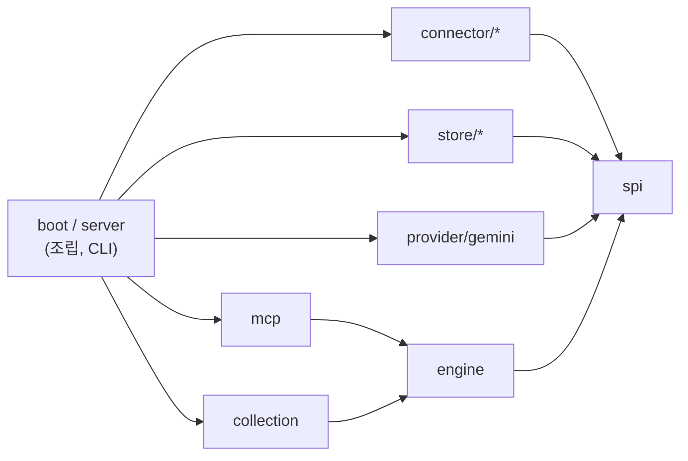

# Semantic Context OS (SCOS)

[English](README.md) | 한국어

SCOS는 Slack·Notion·Jira·Google Drive·Tiro의 문서를 PostgreSQL에 모으고, AI 에이전트가 MCP로 검색·열람·컨텍스트 조립을 할 수 있게 해 주는 서버입니다. 팀이 쌓아 온 업무 기록을 에이전트의 장기 기억처럼 쓰는 것이 목적입니다. 혼자 띄워 쓰는 서버이고, 그 아래의 엔진은 Spring 애플리케이션에 넣어 쓸 수도 있습니다.

Java 21 · Spring Boot 4 · PostgreSQL 17 + pgvector · MIT 라이선스

> [!WARNING]
> **개발 중인 0.1 버전입니다(정식 릴리스 전).** API, 설정, DB 스키마가 바뀔 수 있고, 배포된 아티팩트는 아직 없습니다.
>
> - **한 사람만 쓰는 것을 전제로 합니다.** 인증이 없고, MCP는 **stdio 전송만** 지원합니다(HTTP 전송 없음).
> - **원천 시스템의 권한(ACL)으로 거르지 않습니다.** Slack·Notion·Jira·Drive의 권한을 확인하지 않고, 수집한 문서 전체에서 검색 결과를 돌려줍니다. 서버에 질의할 수 있는 사람은 수집 자격 증명으로 볼 수 있는 모든 문서를 읽을 수 있습니다.
> - **여러 사람이 함께 쓰는 서버로 올리지 마세요.** 혼자 쓰거나, 원천에 대해 이미 같은 권한을 가진 사람끼리만 쓰세요.

## 기능

- **커넥터 5개:** Slack, Notion, Jira, Google Drive, Tiro(회의록, 실험적). 모두 공통 커넥터 SPI를 따라 페이지 단위로 수집합니다.
- **수집 런타임**
  - 페이지마다 변경, 거부 항목, 다음 체크포인트를 한 트랜잭션으로 커밋합니다. 수집이 중간에 끊기면 마지막으로 커밋한 체크포인트에서 이어 갑니다.
  - 반영은 멱등입니다. 바뀌지 않은 항목이 다시 오면 다시 쓰지 않고 '변경 없음'으로 셉니다.
  - 소스마다 점유(lease)와 **fencing token**으로 동시 쓰기를 막습니다. 점유가 넘어갈 때마다 토큰이 올라가고, 저장소는 옛 토큰으로 오는 쓰기를 거부합니다.
  - 전체 동기화가 소스 문서를 지나치게 많이 지우려 하면, 스냅샷 축소 보호가 그 정리를 건너뜁니다.
- **하이브리드 검색**
  - 문서를 제목(heading) 기준으로 나눠 유닛을 만듭니다.
  - 후보는 두 채널에서 찾습니다. 키워드 채널은 일반 PostgreSQL 테이블에 둔 글자 bigram 색인을 쓰고, 벡터 채널은 pgvector를 씁니다. 두 결과는 RRF(reciprocal rank fusion)로 합칩니다.
  - 필요하면 LLM 재정렬(Gemini)로 상위 결과의 순서를 다시 매깁니다. `SCOS_RERANK_PROVIDER=none`으로 끕니다.
- **MCP 도구:** `search_context`, `read_document`, `related_documents`, `assemble_context`. 검색과 조립 결과에는 수집 데이터가 얼마나 최신인지도 함께 실립니다.

임베딩은 지금은 Gemini API(`gemini-embedding-001`, 768차원)만 씁니다. 아래 데모는 이를 로컬 대체 임베더로 바꿔서 API 키 없이 돌아갑니다.

## 빠른 시작 (데모, API 키 불필요)

데모는 Docker로 PostgreSQL + pgvector, 로컬 대체 임베더, SCOS 서버를 띄우고, 가상의 회사를 다룬 합성 문서 52개를 넣습니다. Docker(Compose v2)와 Python 3이 있으면 됩니다. 이미지는 Docker 안에서 빌드하므로 JDK는 없어도 됩니다.

저장소 루트에서 실행합니다.

```bash
# 1. 서버 이미지를 빌드합니다(처음에는 몇 분 걸립니다).
docker compose -f demo/compose.yaml build scos

# 2. PostgreSQL과 임베더를 띄웁니다.
docker compose -f demo/compose.yaml up -d --wait

# 3. 코퍼스를 임베딩합니다.
docker compose -f demo/compose.yaml run --rm corpus

# 4. SCOS에 적재합니다(처음 실행할 때 DB 마이그레이션이 돕니다).
docker compose -f demo/compose.yaml run --rm scos import --file=/work/units.embedded.json --space=demo

# 5. MCP stdio로 질문합니다.
python3 demo/mcp_search.py "결제 중복 승인 장애 원인" -- docker compose -f demo/compose.yaml run --rm -T scos mcp
```

5단계는 대략 이렇게 출력합니다(서버 로그는 stderr로 나갑니다).

```text
server: scos-mcp-server 0.0.1  tools: search_context, read_document, related_documents, assemble_context
search_context("결제 중복 승인 장애 원인", limit=5) -> 5 hits
  1. [jira] OTC-311 결제 승인 재시도 시 원래 멱등 키를 재사용 > 설명  score=0.031  doc=jira/OTC-311
  2. [notion] 포스트모템: 2026-09-07 결제 중복 승인 (SEV1) > 근본 원인  score=0.031  doc=notion/postmortem-2026-09-07-duplicate-charges
  ...
```

정리:

```bash
docker compose -f demo/compose.yaml --profile tools down -v
```

MCP 클라이언트 연결법, 키 없는 임베더의 동작 방식과 한계, 코퍼스 편집 방법은 [demo/README.md](demo/README.md)(영어)에 있습니다. 데모의 해싱 벡터는 뜻이 아니라 철자가 겹치는지를 보므로, 데모 결과로 검색 품질을 판단하지 마세요.

## 서버 실행

서버는 Spring Boot 애플리케이션 하나이고, 명령은 다음과 같습니다.

| 명령 | 하는 일 |
| --- | --- |
| `mcp` | MCP 도구를 stdio로 제공합니다(읽기 전용) |
| `daemon` | 주기적인 수집·투영 루프를 돌립니다 |
| `source …` | 소스를 추가하거나 켜고 끕니다 |
| `collect`, `project`, `cycle` | 수집, 투영, 또는 둘 다를 한 번 직접 돌립니다 |
| `import` | 미리 만든 유닛 JSON 파일을 적재합니다(데모가 씁니다) |
| `status`, `raw …`, `maintenance` | 소스와 실행 상태를 조회하고 정리합니다 |

설정은 환경 변수로 합니다. 예를 들면 `SCOS_DB_URL`, `SCOS_DB_USER`, `SCOS_DB_PASSWORD`, `GEMINI_API_KEY`, `SCOS_SPACE_ID`입니다. 전체 기본값은 `backend/src/main/resources/application.yml`에 있습니다. 설정 레퍼런스와 커넥터 설정 안내는 아직 없습니다.

## 구조



화살표는 의존 방향입니다. 패키지는 모두 `backend/src/main/java`의 `io.scos` 아래에 있습니다.

| 패키지 | 역할 |
| --- | --- |
| `spi` (`connector`, `store`, `embedding`, `projection`) | 포트: 커넥터, 유닛 저장소, 키워드·벡터 색인, 임베더, 투영기. JDK 타입만 씁니다. |
| `engine` | 읽기 파사드 `ContextEngine`과 값 타입, 검색 파이프라인(`internal`), 공용 도우미(`support`) |
| `collection` | 수집 런타임: 점유, 페이지 커밋, 체크포인트, 스케줄, 투영 |
| `connector/{slack,notion,jira,googledrive,tiro}` | 소스 어댑터와 투영기 |
| `store/{postgres,memory}` | 저장소 구현. `memory`는 테스트·실험용입니다. |
| `provider/gemini` | Gemini API 임베더와 텍스트 생성기 |
| `mcp` | MCP stdio 서버와 도구 정의 |
| `server`, `boot` | Spring Boot 애플리케이션, CLI 명령, 조립 |

경계 규칙은 ArchUnit 테스트 [`PublicBoundaryRulesTest`](backend/src/test/java/io/scos/PublicBoundaryRulesTest.java)가 강제하며, 빠른 테스트 층에서 돕니다.

- `spi`는 JDK와 자기 자신에만 의존합니다.
- Spring Boot는 `boot`와 `server`에서만 씁니다.
- `internal` 패키지는 자기 모듈 안(그리고 `boot`/`server` 조립 코드)에서만 씁니다.
- `engine`과 `spi`의 public 시그니처에는 `internal`·`support` 타입이 나오지 않습니다.
- `engine`은 `collection`에 의존하지 않습니다.
- 커넥터끼리는 서로 의존하지 않습니다.
- `boot`는 `server`에 의존하지 않습니다.

## 라이브러리로 쓰기

배포된 아티팩트가 아직 없으므로, 엔진을 넣어 쓰려면 이 저장소에서 직접 빌드해야 합니다. 공개 표면은 `io.scos.engine`과 `io.scos.spi`입니다. `internal`·`support`에 있는 것은 예고 없이 바뀔 수 있습니다.

`ContextEngine.builder()`에는 유닛 저장소, 키워드 색인, 벡터 색인, 임베더가 필요합니다. 아래 예시는 이미 데이터가 들어 있는 PostgreSQL DB(`import`나 데몬으로 적재한 DB)를 읽습니다.

```java
import io.scos.engine.ContextEngine;
import io.scos.engine.SearchQuery;
import io.scos.engine.SearchResult;
import io.scos.spi.embedding.Embedder;
import io.scos.spi.store.Principal;
import io.scos.spi.store.SpaceId;
import io.scos.store.postgres.PostgresKeywordIndex;
import io.scos.store.postgres.PostgresUnitStore;
import io.scos.store.postgres.PostgresVectorIndex;
import org.springframework.jdbc.core.namedparam.NamedParameterJdbcTemplate;
import org.springframework.jdbc.core.simple.JdbcClient;

// dataSource: 마이그레이션을 마친 SCOS DB. embedder: 저장된 벡터를 만든 모델과 같아야 한다.
var jdbc = new NamedParameterJdbcTemplate(dataSource);

ContextEngine engine =
    ContextEngine.builder()
        .units(new PostgresUnitStore(jdbc))
        .keywords(new PostgresKeywordIndex(JdbcClient.create(dataSource)))
        .vectors(new PostgresVectorIndex(jdbc))
        .embedder(embedder)
        .defaultSpace(new SpaceId("demo"))
        .build();

SearchResult result =
    engine.search(Principal.singleUser(), SearchQuery.of("idempotency key for the Order API"));
result.hits().forEach(hit -> System.out.println(hit.documentId() + "  " + hit.title()));
```

엔진에는 이 밖에 `read`, `related`, `assemble`, `freshness`가 있고, MCP 도구와 하나씩 대응합니다. 모든 호출은 첫 인자로 `Principal`을 받습니다. 0.1에서는 이를 전달만 하고 아무것도 거르지 않습니다. 빌더의 선택 설정으로 `reranker(TextGenerator, ObjectMapper)`, `clock`, `meterRegistry`, `lexicalExecutor`가 있습니다. `Embedder`는 메서드 두 개(`dim()`, `embed(texts)`)짜리 인터페이스라서, 다른 임베딩 공급자를 붙이려면 이것만 구현하면 됩니다.

## 빌드와 테스트

Gradle을 돌리려면 JDK 17 이상이 필요합니다. 컴파일과 테스트에 쓰는 JDK 21은 설치되어 있지 않으면 Gradle이 내려받습니다. DB 테스트에는 Docker도 필요합니다.

```bash
cd backend
./gradlew check
```

`check`는 Spotless(포맷)를 검사하고 Error Prone으로 컴파일한 뒤, 모든 테스트 층을 돌립니다.

| 태스크 | 내용 |
| --- | --- |
| `fastTest` | JVM만 쓰는 테스트. ArchUnit 규칙도 여기서 돕니다. 작업하는 동안 돌립니다. |
| `processTest` | 셸 스크립트나 자식 JVM을 띄우는 테스트(`@Tag("process")`) |
| `test` | `fastTest` + `processTest` |
| `dbTest` | Testcontainers로 띄운 PostgreSQL에서 하는 계약·통합·장애 테스트(`@Tag("db")`). Docker가 없으면 건너뛰지 않고 실패합니다. |
| `harnessTest` | `harness/`에 있는 MCP 비교 하네스의 자체 테스트 |

`perfTest`(측정 프로브)는 `check`에 들어가지 않습니다.

## 로드맵

계획이며 일정은 정하지 않았습니다.

- **다중 사용자:** MCP HTTP 전송, 인증, 원천 시스템 권한(ACL)에 따른 접근 필터
- **메모리 층:** 수집한 문서 위에 사용자별·팀별 기억을 두는 층
- **임베딩 공급자 추가:** OpenAI 호환 HTTP 임베더. Ollama 같은 로컬 서버도 이것으로 붙일 수 있습니다.
- 아티팩트와 컨테이너 이미지 배포

## 라이선스

[MIT](LICENSE)
