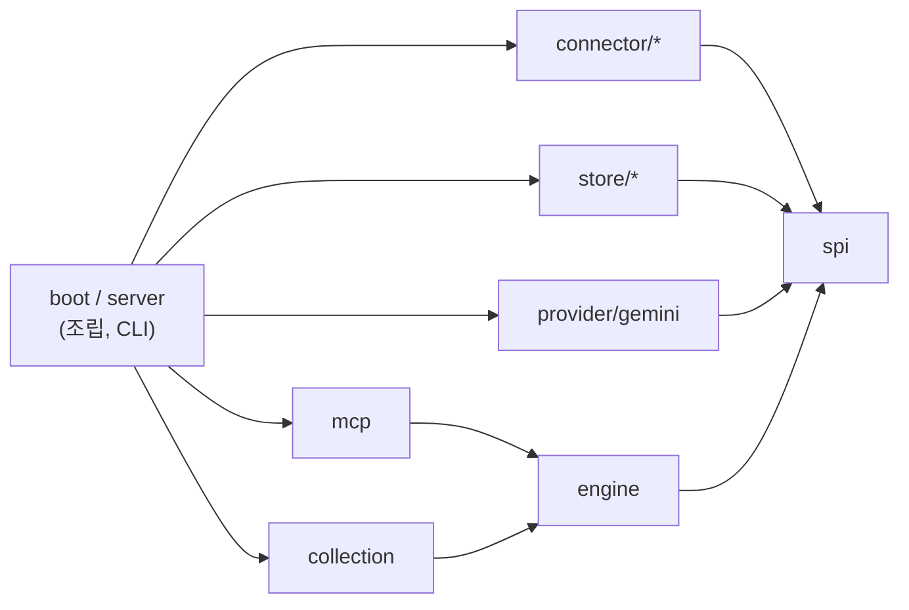

# Semantic Context OS (SCOS)

[English](README.md) | 한국어

SCOS는 Slack·Notion·Jira·Google Drive·Tiro의 문서를 PostgreSQL에 모으고, AI 에이전트가 MCP로 검색·열람·컨텍스트 조립을 할 수 있게 해 주는 서버입니다. 한마디로 AI 에이전트를 위한 조직의 장기 의미 기억(semantic memory)과 그 검색 층입니다. 에이전트는 팀이 쌓아 온 업무 기록에서 필요한 것을 찾아 읽고, 컨텍스트로 묶어 씁니다. 혼자 띄워 쓰는 서버이고, 그 아래의 엔진은 Spring 애플리케이션에 넣어 쓸 수도 있습니다.

Java 21 · Spring Boot 4 · PostgreSQL 17 + pgvector · MIT 라이선스

> [!WARNING]
> **개발 중인 0.1 버전입니다(정식 릴리스 전).** API, 설정, DB 스키마가 바뀔 수 있고, 배포된 아티팩트는 아직 없습니다.
>
> - **한 사람만 쓰는 것을 전제로 합니다.** 인증이 없고, MCP는 **stdio 전송만** 지원합니다(HTTP 전송 없음).
> - **원천 시스템의 권한(ACL)으로 거르지 않습니다.** Slack·Notion·Jira·Drive의 권한을 확인하지 않고, 수집한 문서 전체에서 검색 결과를 돌려줍니다. 서버에 질의할 수 있는 사람은 수집 자격 증명으로 볼 수 있는 모든 문서를 읽을 수 있습니다.
> - **여러 사람이 함께 쓰는 서버로 올리지 마세요.** 혼자 쓰거나, 원천에 대해 이미 같은 권한을 가진 사람끼리만 쓰세요.

## 배경

SCOS는 LY Corporation Tech Blog의 글 [「시멘틱 컨텍스트 OS 설계: 에이전트 시스템의 토큰 스터핑을 넘어」](https://techblog.lycorp.co.jp/ko/techverse2026-59)(Tech-Verse 2026, 2026-06-24 게시)가 던진 문제에서 출발했습니다. 컨텍스트 창이 커졌다고 에이전트가 더 잘 일하지는 않으니, 컨텍스트는 밀어 넣을 것이 아니라 골라서 관리해야 한다는 문제의식입니다. "Semantic Context OS"라는 이름도 그 글에서 왔습니다. 그 글에서 이 이름은 저자들이 사내에서 설계한 런타임을 가리킵니다.

이 저장소는 개인 프로젝트입니다. LY Corporation과 관계가 없고, 그 글에 나온 시스템을 구현한 것도 아닙니다. 둘은 같은 문제의 서로 다른 부분을 다룹니다.

| | LY 글 | SCOS |
| --- | --- | --- |
| 위치 | 에이전트와 모델 API 사이의 로컬 프록시 | 에이전트가 도구로 호출하는 MCP 서버 |
| 대상 | 소프트웨어 엔지니어링 에이전트의 컨텍스트(코드베이스와 실행 중인 세션) | Slack·Notion·Jira·Google Drive·Tiro에서 모은 팀의 업무 기록 |
| 핵심 기법 | 컨텍스트를 나눠 담는 가상 파일 시스템, 톱니(sawtooth) 압축, AST 기반 가지치기(PathAlign) | 수집과 유닛 투영, 하이브리드 검색(글자 bigram + 벡터, RRF로 결합), 선택적 LLM 재정렬, 토큰 예산 조립 |

아래 기억 분류로 말하면, 그 글은 에이전트가 실행되는 동안의 작업 기억을 관리합니다. SCOS는 에이전트가 작업 기억으로 끌어올 의미 기억을 공급합니다. 서로 겨루는 관계가 아니라 맞물리는 관계입니다.

## 에이전트 기억 분류 속 SCOS의 위치

CoALA([Sumers 외, 2024](#긴-컨텍스트와-에이전트-기억))는 언어 에이전트의 기억을 네 가지로 나눕니다. SCOS는 그중 하나를 맡고, 나머지는 로드맵에서 다룹니다.

| 기억 | 담는 것 | SCOS 0.1 | 계획 |
| --- | --- | --- | --- |
| 작업 기억 | 지금 컨텍스트 창에 올라와 있는 것 | 토큰 예산 조립만: `assemble_context`가 검색 결과로 예산을 채우고 순서를 정합니다 | 컨텍스트 종류별 예산 배분, 압축 |
| 일화 기억 | 지난 작업에서 일어난 일 | 없음 | 에이전트가 한 일과 알게 된 것을 적는 쓰기 도구(`remember`) |
| **의미 기억** | 사실과 지식 | **핵심:** 조직의 문서를 모으고, 색인하고, 검색해서 내줍니다 | — |
| 절차 기억 | 규칙과 일하는 방법 | 없음 | 항상 포함되고 압축되지 않는 규칙 |

## 기능

- **커넥터 5개:** Slack, Notion, Jira, Google Drive, Tiro(회의록, 실험적). 모두 공통 커넥터 SPI를 따라 페이지 단위로 수집합니다.
- **수집 런타임**
  - 페이지마다 변경, 거부 항목, 다음 체크포인트를 한 트랜잭션으로 커밋합니다. 수집이 중간에 끊기면 마지막으로 커밋한 체크포인트에서 이어 갑니다.
  - 반영은 멱등입니다. 바뀌지 않은 항목이 다시 오면 다시 쓰지 않고 '변경 없음'으로 셉니다.
  - 소스마다 점유(lease)와 **fencing token**으로 동시 쓰기를 막습니다. 점유가 넘어갈 때마다 토큰이 올라가고, 저장소는 옛 토큰으로 오는 쓰기를 거부합니다.
  - 전체 동기화가 소스 문서를 지나치게 많이 지우려 하면, 스냅샷 축소 보호가 그 정리를 건너뜁니다.
- **하이브리드 검색**
  - 문서를 제목(heading) 기준으로 나눠 유닛을 만듭니다.
  - 후보는 두 채널에서 찾습니다. 키워드 채널은 일반 PostgreSQL 테이블에 둔 글자 bigram 색인을 쓰고, 벡터 채널은 pgvector를 씁니다. 두 결과는 RRF(reciprocal rank fusion)로 합칩니다.
  - 필요하면 LLM 재정렬(Gemini)로 상위 결과의 순서를 다시 매깁니다. `SCOS_RERANK_PROVIDER=none`으로 끕니다.
- **MCP 도구:** `search_context`, `read_document`, `related_documents`, `assemble_context`. 검색과 조립 결과에는 수집 데이터가 얼마나 최신인지도 함께 실립니다.

임베딩은 지금은 Gemini API(`gemini-embedding-001`, 768차원)만 씁니다. 아래 데모는 이를 로컬 대체 임베더로 바꿔서 API 키 없이 돌아갑니다.

## 빠른 시작 (데모, API 키 불필요)

데모는 Docker로 PostgreSQL + pgvector, 로컬 대체 임베더, SCOS 서버를 띄우고, 가상의 회사를 다룬 합성 문서 52개를 넣습니다. Docker(Compose v2)와 Python 3이 있으면 됩니다. 이미지는 Docker 안에서 빌드하므로 JDK는 없어도 됩니다.

저장소 루트에서 실행합니다.

```bash
# 1. 서버 이미지를 빌드합니다(처음에는 몇 분 걸립니다).
docker compose -f demo/compose.yaml build scos

# 2. PostgreSQL과 임베더를 띄웁니다.
docker compose -f demo/compose.yaml up -d --wait

# 3. 코퍼스를 임베딩합니다.
docker compose -f demo/compose.yaml run --rm corpus

# 4. SCOS에 적재합니다(처음 실행할 때 DB 마이그레이션이 돕니다).
docker compose -f demo/compose.yaml run --rm scos import --file=/work/units.embedded.json --space=demo

# 5. MCP stdio로 질문합니다.
python3 demo/mcp_search.py "결제 중복 승인 장애 원인" -- docker compose -f demo/compose.yaml run --rm -T scos mcp
```

5단계는 대략 이렇게 출력합니다(서버 로그는 stderr로 나갑니다).

```text
server: scos-mcp-server 0.0.1  tools: search_context, read_document, related_documents, assemble_context
search_context("결제 중복 승인 장애 원인", limit=5) -> 5 hits
  1. [jira] OTC-311 결제 승인 재시도 시 원래 멱등 키를 재사용 > 설명  score=0.031  doc=jira/OTC-311
  2. [notion] 포스트모템: 2026-09-07 결제 중복 승인 (SEV1) > 근본 원인  score=0.031  doc=notion/postmortem-2026-09-07-duplicate-charges
  ...
```

정리:

```bash
docker compose -f demo/compose.yaml --profile tools down -v
```

MCP 클라이언트 연결법, 키 없는 임베더의 동작 방식과 한계, 코퍼스 편집 방법은 [demo/README.md](demo/README.md)(영어)에 있습니다. 데모의 해싱 벡터는 뜻이 아니라 철자가 겹치는지를 보므로, 데모 결과로 검색 품질을 판단하지 마세요.

## 서버 실행

서버는 Spring Boot 애플리케이션 하나이고, 명령은 다음과 같습니다.

| 명령 | 하는 일 |
| --- | --- |
| `mcp` | MCP 도구를 stdio로 제공합니다(읽기 전용) |
| `daemon` | 주기적인 수집·투영 루프를 돌립니다 |
| `source …` | 소스를 추가하거나 켜고 끕니다 |
| `collect`, `project`, `cycle` | 수집, 투영, 또는 둘 다를 한 번 직접 돌립니다 |
| `import` | 미리 만든 유닛 JSON 파일을 적재합니다(데모가 씁니다) |
| `status`, `raw …`, `maintenance` | 소스와 실행 상태를 조회하고 정리합니다 |

설정은 환경 변수로 합니다. 예를 들면 `SCOS_DB_URL`, `SCOS_DB_USER`, `SCOS_DB_PASSWORD`, `GEMINI_API_KEY`, `SCOS_SPACE_ID`입니다. 전체 기본값은 `backend/src/main/resources/application.yml`에 있습니다. 설정 레퍼런스와 커넥터 설정 안내는 아직 없습니다.

## 구조



화살표는 의존 방향입니다. 패키지는 모두 `backend/src/main/java`의 `io.scos` 아래에 있습니다.

| 패키지 | 역할 |
| --- | --- |
| `spi` (`connector`, `store`, `embedding`, `projection`) | 포트: 커넥터, 유닛 저장소, 키워드·벡터 색인, 임베더, 투영기. JDK 타입만 씁니다. |
| `engine` | 읽기 파사드 `ContextEngine`과 값 타입, 검색 파이프라인(`internal`), 공용 도우미(`support`) |
| `collection` | 수집 런타임: 점유, 페이지 커밋, 체크포인트, 스케줄, 투영 |
| `connector/{slack,notion,jira,googledrive,tiro}` | 소스 어댑터와 투영기 |
| `store/{postgres,memory}` | 저장소 구현. `memory`는 테스트·실험용입니다. |
| `provider/gemini` | Gemini API 임베더와 텍스트 생성기 |
| `mcp` | MCP stdio 서버와 도구 정의 |
| `server`, `boot` | Spring Boot 애플리케이션, CLI 명령, 조립 |

경계 규칙은 ArchUnit 테스트 [`PublicBoundaryRulesTest`](backend/src/test/java/io/scos/PublicBoundaryRulesTest.java)가 강제하며, 빠른 테스트 층에서 돕니다.

- `spi`는 JDK와 자기 자신에만 의존합니다.
- Spring Boot는 `boot`와 `server`에서만 씁니다.
- `internal` 패키지는 자기 모듈 안(그리고 `boot`/`server` 조립 코드)에서만 씁니다.
- `engine`과 `spi`의 public 시그니처에는 `internal`·`support` 타입이 나오지 않습니다.
- `engine`은 `collection`에 의존하지 않습니다.
- 커넥터끼리는 서로 의존하지 않습니다.
- `boot`는 `server`에 의존하지 않습니다.

## 라이브러리로 쓰기

배포된 아티팩트가 아직 없으므로, 엔진을 넣어 쓰려면 이 저장소에서 직접 빌드해야 합니다. 공개 표면은 `io.scos.engine`과 `io.scos.spi`입니다. `internal`·`support`에 있는 것은 예고 없이 바뀔 수 있습니다.

`ContextEngine.builder()`에는 유닛 저장소, 키워드 색인, 벡터 색인, 임베더가 필요합니다. 아래 예시는 이미 데이터가 들어 있는 PostgreSQL DB(`import`나 데몬으로 적재한 DB)를 읽습니다.

```java
import io.scos.engine.ContextEngine;
import io.scos.engine.SearchQuery;
import io.scos.engine.SearchResult;
import io.scos.spi.embedding.Embedder;
import io.scos.spi.store.Principal;
import io.scos.spi.store.SpaceId;
import io.scos.store.postgres.PostgresKeywordIndex;
import io.scos.store.postgres.PostgresUnitStore;
import io.scos.store.postgres.PostgresVectorIndex;
import org.springframework.jdbc.core.namedparam.NamedParameterJdbcTemplate;
import org.springframework.jdbc.core.simple.JdbcClient;

// dataSource: 마이그레이션을 마친 SCOS DB. embedder: 저장된 벡터를 만든 모델과 같아야 한다.
var jdbc = new NamedParameterJdbcTemplate(dataSource);

ContextEngine engine =
    ContextEngine.builder()
        .units(new PostgresUnitStore(jdbc))
        .keywords(new PostgresKeywordIndex(JdbcClient.create(dataSource)))
        .vectors(new PostgresVectorIndex(jdbc))
        .embedder(embedder)
        .defaultSpace(new SpaceId("demo"))
        .build();

SearchResult result =
    engine.search(Principal.singleUser(), SearchQuery.of("idempotency key for the Order API"));
result.hits().forEach(hit -> System.out.println(hit.documentId() + "  " + hit.title()));
```

엔진에는 이 밖에 `read`, `related`, `assemble`, `freshness`가 있고, MCP 도구와 하나씩 대응합니다. 모든 호출은 첫 인자로 `Principal`을 받습니다. 0.1에서는 이를 전달만 하고 아무것도 거르지 않습니다. 빌더의 선택 설정으로 `reranker(TextGenerator, ObjectMapper)`, `clock`, `meterRegistry`, `lexicalExecutor`가 있습니다. `Embedder`는 메서드 두 개(`dim()`, `embed(texts)`)짜리 인터페이스라서, 다른 임베딩 공급자를 붙이려면 이것만 구현하면 됩니다.

## 빌드와 테스트

Gradle을 돌리려면 JDK 17 이상이 필요합니다. 컴파일과 테스트에 쓰는 JDK 21은 설치되어 있지 않으면 Gradle이 내려받습니다. DB 테스트에는 Docker도 필요합니다.

```bash
cd backend
./gradlew check
```

`check`는 Spotless(포맷)를 검사하고 Error Prone으로 컴파일한 뒤, 모든 테스트 층을 돌립니다.

| 태스크 | 내용 |
| --- | --- |
| `fastTest` | JVM만 쓰는 테스트. ArchUnit 규칙도 여기서 돕니다. 작업하는 동안 돌립니다. |
| `processTest` | 셸 스크립트나 자식 JVM을 띄우는 테스트(`@Tag("process")`) |
| `test` | `fastTest` + `processTest` |
| `dbTest` | Testcontainers로 띄운 PostgreSQL에서 하는 계약·통합·장애 테스트(`@Tag("db")`). Docker가 없으면 건너뛰지 않고 실패합니다. |
| `harnessTest` | `harness/`에 있는 MCP 비교 하네스의 자체 테스트 |

`perfTest`(측정 프로브)는 `check`에 들어가지 않습니다.

## 로드맵

계획이며 일정은 정하지 않았습니다.

- **다중 사용자:** MCP HTTP 전송, 인증, 원천 시스템 권한(ACL)에 따른 접근 필터
- **메모리 층:** 수집한 문서 위에 사용자별·팀별 기억을 두는 층
- **임베딩 공급자 추가:** OpenAI 호환 HTTP 임베더. Ollama 같은 로컬 서버도 이것으로 붙일 수 있습니다.
- 아티팩트와 컨테이너 이미지 배포

## 참고문헌

항목마다 이 코드의 어디에 쓰였는지 적었습니다. "0.1에는 없음"은 로드맵의 참고로만 쓴다는 뜻입니다.

### 검색·랭킹

- P. Lewis 외. *Retrieval-Augmented Generation for Knowledge-Intensive NLP Tasks.* NeurIPS 2020. [arXiv:2005.11401](https://arxiv.org/abs/2005.11401)
  전체 구조의 바탕입니다. SCOS는 그중 검색 쪽을 맡아 관련 구절을 찾아 돌려주고, 생성은 호출한 에이전트가 합니다.
- V. Karpukhin 외. *Dense Passage Retrieval for Open-Domain Question Answering.* EMNLP 2020. [doi:10.18653/v1/2020.emnlp-main.550](https://doi.org/10.18653/v1/2020.emnlp-main.550)
  벡터 채널입니다. 질의와 유닛을 같은 공간에 임베딩하고 코사인 유사도로 비교합니다(`PostgresVectorIndex`).
- G. V. Cormack, C. L. A. Clarke, S. Büttcher. *Reciprocal Rank Fusion Outperforms Condorcet and Individual Rank Learning Methods.* SIGIR 2009. [doi:10.1145/1571941.1572114](https://doi.org/10.1145/1571941.1572114)
  `Rrf`가 키워드·벡터·링크 문서 순위와 질의 변형별 순위를 가중치 / (k + 순위 + 1), k = 60으로 합칩니다. `related_documents`도 같은 식을 씁니다.
- W. Sun 외. *Is ChatGPT Good at Search? Investigating Large Language Models as Re-Ranking Agents.* EMNLP 2023. [doi:10.18653/v1/2023.emnlp-main.923](https://doi.org/10.18653/v1/2023.emnlp-main.923)
  `LlmReranker`의 listwise 재정렬입니다. 상위 후보(기본 30개)를 한 프롬프트에 담아 보내고, 후보 번호의 순서를 받아 다시 줄 세웁니다. 응답이 올바른 순서가 아니면 원래 순위를 그대로 둡니다.
- Yu. A. Malkov, D. A. Yashunin. *Efficient and Robust Approximate Nearest Neighbor Search Using Hierarchical Navigable Small World Graphs.* IEEE TPAMI 42(4), 2020. [doi:10.1109/TPAMI.2018.2889473](https://doi.org/10.1109/TPAMI.2018.2889473)
  검토하고 보류한 대안입니다. 지금 벡터 채널은 HNSW·IVFFlat 색인 없이 pgvector 정확 스캔으로 찾습니다.

### 긴 컨텍스트와 에이전트 기억

- N. F. Liu 외. *Lost in the Middle: How Language Models Use Long Contexts.* TACL 12, 2024. [doi:10.1162/tacl_a_00638](https://doi.org/10.1162/tacl_a_00638)
  `ContextAssembler`는 순위가 높은 유닛을 묶음의 앞과 뒤에, 낮은 유닛을 가운데에 둡니다(U자 배치).
- K. Hong, A. Troynikov, J. Huber. *Context Rot: How Increasing Input Tokens Impacts LLM Performance.* Chroma 기술 보고서, 2025. [trychroma.com/research/context-rot](https://www.trychroma.com/research/context-rot)
  `assemble_context`의 전제입니다. 문서를 통째로 넣지 않고, 관련 있는 유닛만 토큰 예산(기본 2,000, 최대 8,000) 안에서 골라 돌려줍니다.
- T. R. Sumers, S. Yao, K. Narasimhan, T. L. Griffiths. *Cognitive Architectures for Language Agents.* TMLR 2024. [arXiv:2309.02427](https://arxiv.org/abs/2309.02427)
  [에이전트 기억 분류 속 SCOS의 위치](#에이전트-기억-분류-속-scos의-위치)에서 쓴 기억 분류입니다.
- C. Packer 외. *MemGPT: Towards LLMs as Operating Systems.* 2023. [arXiv:2310.08560](https://arxiv.org/abs/2310.08560)
  0.1에는 없음. 컨텍스트 창과 외부 저장소를 나누고 메모리가 차면 압축하는 구조가, 계획 중인 작업 기억 압축의 참고입니다. 유닛 저장소에는 이미 `raw`·`compacted`·`archived` 티어가 있고 검색과 조립도 compacted 유닛을 다루지만, 0.1에는 그 유닛을 만드는 압축기가 없습니다.
- J. S. Park 외. *Generative Agents: Interactive Simulacra of Human Behavior.* UIST 2023. [doi:10.1145/3586183.3606763](https://doi.org/10.1145/3586183.3606763)
  이 논문의 기억 검색은 최신성·중요도·관련도를 함께 봅니다. SCOS는 관련도로 순위를 매기고 작은 최신성 계수 1 + 0.1 · 0.99^일수를 곱합니다. `assemble_context`에서는 늘, 검색에서는 질의가 최근 정보를 물을 때만 곱합니다. 중요도 점수와 에이전트 자신의 경험을 쌓는 기억 흐름은 0.1에 없습니다(위 일화 기억 참고).
- LY Corporation Tech Blog. *시멘틱 컨텍스트 OS 설계: 에이전트 시스템의 토큰 스터핑을 넘어.* Tech-Verse 2026. [techblog.lycorp.co.jp/ko/techverse2026-59](https://techblog.lycorp.co.jp/ko/techverse2026-59)
  SCOS가 출발한 문제를 코딩 에이전트 쪽에서 다룬 글입니다. [배경](#배경)을 보세요.
- *Model Context Protocol* 명세. [modelcontextprotocol.io/specification](https://modelcontextprotocol.io/specification)
  서빙 인터페이스입니다. 도구 네 개를 stdio로 제공합니다(`backend/src/main/java/io/scos/mcp`).

### 평가

- W. Webber, A. Moffat, J. Zobel. *A Similarity Measure for Indefinite Rankings.* ACM TOIS 28(4), 2010. [doi:10.1145/1852102.1852106](https://doi.org/10.1145/1852102.1852106)
  [`harness/`](harness/README.md)의 `o2Compare` 태스크는 두 MCP 서버에 같은 질의를 보내고, 두 순위를 RBO(rank-biased overlap, p = 0.9)와 Jaccard@k, 1위 일치로 비교합니다. 이전 TypeScript 구현과 Java 구현을 비교할 때 썼습니다.

### 신뢰성·검증

- C. G. Gray, D. R. Cheriton. *Leases: An Efficient Fault-Tolerant Mechanism for Distributed File Cache Consistency.* SOSP 1989. [doi:10.1145/74850.74870](https://doi.org/10.1145/74850.74870)
  수집 작업자는 소스마다 점유(lease)를 잡고, 갱신하지 않으면 점유가 만료됩니다(`WorkClaim`, `LeaseHeartbeat`).
- M. Kleppmann. *How to do distributed locking.* 2016. [martin.kleppmann.com](https://martin.kleppmann.com/2016/02/08/how-to-do-distributed-locking.html)
  점유에 붙는 fencing token입니다. 점유가 넘어갈 때마다 토큰이 올라가고, 저장소는 옛 토큰으로 오는 쓰기를 거부합니다.
- R. A. DeMillo, R. J. Lipton, F. G. Sayward. *Hints on Test Data Selection: Help for the Practicing Programmer.* IEEE Computer 11(4), 1978. [doi:10.1109/C-M.1978.218136](https://doi.org/10.1109/C-M.1978.218136)
  검색 파이프라인, 점유, 페이지 커밋, 커넥터 같은 정책 클래스에 PIT로 변이 테스트를 합니다. `check`에는 들어가지 않고, 직접 돌리거나 `pitest` 라벨을 붙인 PR에서 돕니다.
- M. Feathers. *Working Effectively with Legacy Code.* Prentice Hall, 2004.
  특성화 테스트(characterization test)입니다. `harness/fixtures/`의 골든 픽스처는 이전 TypeScript 구현에서 기록한 것이고, `javaTest`가 이를 Java 서버에 다시 돌려 같은 동작을 하는지 확인합니다.

## 라이선스

[MIT](LICENSE)
