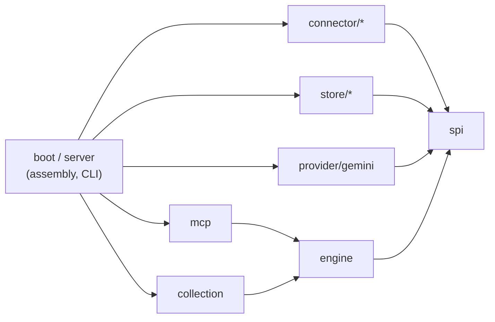

# Semantic Context OS (SCOS)

English | [한국어](README.ko.md)

SCOS collects documents from Slack, Notion, Jira, Google Drive and Tiro into PostgreSQL and serves them to AI agents over MCP. It works as long-term memory for agents: they search, read and assemble context from a team's own work history. It is a server you run for yourself, and the engine underneath it can be embedded in a Spring application.

Java 21 · Spring Boot 4 · PostgreSQL 17 with pgvector · MIT license

> [!WARNING]
> **Work in progress (0.1, pre-release).** APIs, configuration and the database schema can still change. No artifacts are published yet.
>
> - **Single user only.** There is no authentication. MCP runs over **stdio only**. There is no HTTP transport.
> - **No access control from the source systems.** SCOS does not check Slack, Notion, Jira or Drive permissions. Every search returns from everything it has collected. Anyone who can query the server can read every document the collection credentials can see.
> - **Do not run it as a shared server.** Use it for yourself, or only with people who already have the same access to the sources.

## Features

- **Five connectors:** Slack, Notion, Jira, Google Drive, and Tiro (meeting notes, experimental). Each one collects page by page through a common connector SPI.
- **Collection runtime**
  - Every page commits in one transaction: changes, rejected items and the next checkpoint. An interrupted run resumes from the last committed checkpoint.
  - Commits are idempotent. If a page delivers an item that has not changed, it is counted as unchanged and not rewritten.
  - A lease with a **fencing token** guards each source. The token goes up each time the claim changes hands, and the store rejects writes that carry an old token.
  - A snapshot shrink guard skips the cleanup when a full sync would delete too large a share of a source.
- **Hybrid search**
  - Documents are split into units by heading.
  - Two channels find candidates: a keyword channel on a character-bigram index in plain PostgreSQL tables, and a vector channel on pgvector. Reciprocal rank fusion merges them.
  - Optional LLM reranking (Gemini) can reorder the top results. Turn it off with `SCOS_RERANK_PROVIDER=none`.
- **MCP tools:** `search_context`, `read_document`, `related_documents`, `assemble_context`. Search and assemble results also report how fresh the collected data is.

Embeddings use the Gemini API (`gemini-embedding-001`, 768 dimensions) for now. The demo below replaces it with a local stand-in, so it needs no key.

## Quickstart (demo, no API key)

The demo runs PostgreSQL with pgvector, a local stand-in embedder and the SCOS server in Docker. It loads a synthetic corpus of 52 documents from a made-up company. You need Docker with Compose v2 and Python 3. You do not need a JDK, because the image is built inside Docker.

Run these from the repository root:

```bash
# 1. Build the server image (the first build takes a few minutes).
docker compose -f demo/compose.yaml build scos

# 2. Start PostgreSQL and the embedder.
docker compose -f demo/compose.yaml up -d --wait

# 3. Embed the corpus.
docker compose -f demo/compose.yaml run --rm corpus

# 4. Load it into SCOS (runs the database migrations on first use).
docker compose -f demo/compose.yaml run --rm scos import --file=/work/units.embedded.json --space=demo

# 5. Ask a question over MCP stdio.
python3 demo/mcp_search.py "How do clients send an idempotency key to the Order API?" -- docker compose -f demo/compose.yaml run --rm -T scos mcp
```

Step 5 prints something like this (server logs go to stderr):

```text
server: scos-mcp-server 0.0.1  tools: search_context, read_document, related_documents, assemble_context
search_context("How do clients send an idempotency key to the Order API?", limit=5) -> 5 hits
  1. [notion] Order API v2 design > Idempotency  score=0.047  doc=notion/order-api-v2-design
  ...
```

Clean up:

```bash
docker compose -f demo/compose.yaml --profile tools down -v
```

[demo/README.md](demo/README.md) has the rest: how to connect any MCP client to it, how the keyless embedder works, its limits, and how to edit the corpus. The demo's hashing vectors match spelling, not meaning, so do not use the demo to judge search quality.

## Running the server

The server is one Spring Boot application with these commands:

| Command | What it does |
| --- | --- |
| `mcp` | Serve the MCP tools over stdio (read-only) |
| `daemon` | Run the scheduled collection and projection loop |
| `source …` | Add, enable or disable a source |
| `collect`, `project`, `cycle` | Run one collection, one projection, or both, by hand |
| `import` | Load pre-built units from a JSON file (the demo uses this) |
| `status`, `raw …`, `maintenance` | Inspect sources and runs, and clean up |

You configure it with environment variables, for example `SCOS_DB_URL`, `SCOS_DB_USER`, `SCOS_DB_PASSWORD`, `GEMINI_API_KEY` and `SCOS_SPACE_ID`. All the defaults are in `backend/src/main/resources/application.yml`. There is no configuration reference or connector setup guide yet.

## Architecture



Arrows point from a package to the packages it depends on. All packages are under `io.scos` in `backend/src/main/java`:

| Package | Role |
| --- | --- |
| `spi` (`connector`, `store`, `embedding`, `projection`) | Ports: connector, unit store, keyword and vector index, embedder, projector. JDK types only. |
| `engine` | `ContextEngine` read facade, value types, search pipeline (`internal`), shared helpers (`support`) |
| `collection` | Collection runtime: leases, page commits, checkpoints, scheduling, projection |
| `connector/{slack,notion,jira,googledrive,tiro}` | Source adapters and projectors |
| `store/{postgres,memory}` | Store implementations. `memory` is for tests and experiments. |
| `provider/gemini` | Embedder and text generator over the Gemini API |
| `mcp` | MCP stdio server and tool definitions |
| `server`, `boot` | Spring Boot application, CLI commands, wiring |

ArchUnit enforces these boundaries in [`PublicBoundaryRulesTest`](backend/src/test/java/io/scos/PublicBoundaryRulesTest.java), which runs in the fast test tier:

- `spi` depends only on the JDK and itself.
- Spring Boot is used only in `boot` and `server`.
- An `internal` package is used only inside its own module (and by the `boot`/`server` wiring).
- Public signatures in `engine` and `spi` never mention `internal` or `support` types.
- `engine` does not depend on `collection`.
- Connectors do not depend on each other.
- `boot` does not depend on `server`.

## Using the engine as a library

No artifact is published yet. To embed the engine you build it from this repository. The public surface is `io.scos.engine` and `io.scos.spi`. Anything in `internal` or `support` can change without notice.

`ContextEngine.builder()` needs a unit store, a keyword index, a vector index and an embedder. This example reads a PostgreSQL database that already holds data, for example one loaded by `import` or by the daemon:

```java
import io.scos.engine.ContextEngine;
import io.scos.engine.SearchQuery;
import io.scos.engine.SearchResult;
import io.scos.spi.embedding.Embedder;
import io.scos.spi.store.Principal;
import io.scos.spi.store.SpaceId;
import io.scos.store.postgres.PostgresKeywordIndex;
import io.scos.store.postgres.PostgresUnitStore;
import io.scos.store.postgres.PostgresVectorIndex;
import org.springframework.jdbc.core.namedparam.NamedParameterJdbcTemplate;
import org.springframework.jdbc.core.simple.JdbcClient;

// dataSource: a migrated SCOS database. embedder: must match the model that produced the stored vectors.
var jdbc = new NamedParameterJdbcTemplate(dataSource);

ContextEngine engine =
    ContextEngine.builder()
        .units(new PostgresUnitStore(jdbc))
        .keywords(new PostgresKeywordIndex(JdbcClient.create(dataSource)))
        .vectors(new PostgresVectorIndex(jdbc))
        .embedder(embedder)
        .defaultSpace(new SpaceId("demo"))
        .build();

SearchResult result =
    engine.search(Principal.singleUser(), SearchQuery.of("idempotency key for the Order API"));
result.hits().forEach(hit -> System.out.println(hit.documentId() + "  " + hit.title()));
```

The engine also has `read`, `related`, `assemble` and `freshness`, one for each MCP tool. Every call takes a `Principal` first. In 0.1 the engine only passes it along and filters nothing. Optional builder settings are `reranker(TextGenerator, ObjectMapper)`, `clock`, `meterRegistry` and `lexicalExecutor`. `Embedder` is a two-method interface (`dim()`, `embed(texts)`), so you can plug in another embedding provider.

## Build and test

You need a JDK 17 or newer to run Gradle. Gradle downloads JDK 21 for compiling and testing if it is not installed. The database tests also need Docker.

```bash
cd backend
./gradlew check
```

`check` runs Spotless (formatting) and compiles with Error Prone. It then runs every test tier:

| Task | What it runs |
| --- | --- |
| `fastTest` | JVM-only tests, including the ArchUnit rules. Use it while you work. |
| `processTest` | Tests that start shell scripts or child JVMs (`@Tag("process")`) |
| `test` | `fastTest` + `processTest` |
| `dbTest` | PostgreSQL contract, integration and failure tests with Testcontainers (`@Tag("db")`). If Docker is missing, it fails rather than skips. |
| `harnessTest` | Self-tests of the MCP comparison harness in `harness/` |

`perfTest` (measurement probes) is not part of `check`.

## Roadmap

Planned, with no dates:

- **Multiple users:** an HTTP transport for MCP, authentication, and access filtering based on source-system permissions (ACLs)
- **A memory layer:** per-user and per-team memory on top of the collected documents
- **More embedding providers:** an OpenAI-compatible HTTP embedder, which would also cover local servers such as Ollama
- Published artifacts and a container image

## License

[MIT](LICENSE)
