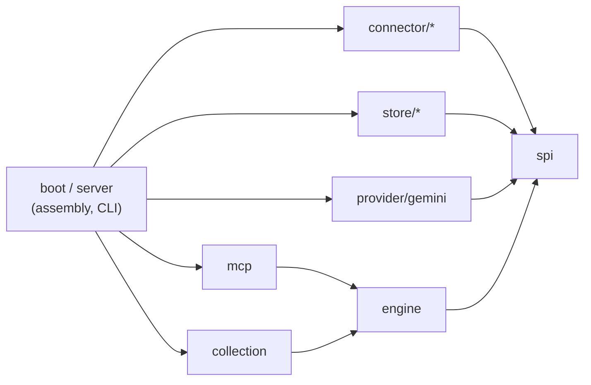

# Semantic Context OS (SCOS)

English | [한국어](README.ko.md)

SCOS collects documents from Slack, Notion, Jira, Google Drive and Tiro into PostgreSQL and serves them to AI agents over MCP. It is an organization's long-term semantic memory for AI agents, together with the retrieval layer over it: agents search, read and assemble context from a team's own work history. It is a server you run for yourself, and the engine underneath it can be embedded in a Spring application.

Java 21 · Spring Boot 4 · PostgreSQL 17 with pgvector · MIT license

> [!WARNING]
> **Work in progress (0.1, pre-release).** APIs, configuration and the database schema can still change. No artifacts are published yet.
>
> - **Single user only.** There is no authentication. MCP runs over **stdio only**. There is no HTTP transport.
> - **No access control from the source systems.** SCOS does not check Slack, Notion, Jira or Drive permissions. Every search returns from everything it has collected. Anyone who can query the server can read every document the collection credentials can see.
> - **Do not run it as a shared server.** Use it for yourself, or only with people who already have the same access to the sources.

## Background

SCOS started from the problem set out in the LY Corporation Tech Blog article [*Architecting Semantic Context OS: Beyond token stuffing in agentic systems*](https://techblog.lycorp.co.jp/en/techverse2026-59) (Tech-Verse 2026, published 2026-06-24; [Korean version](https://techblog.lycorp.co.jp/ko/techverse2026-59)). A larger context window does not by itself make an agent work better. Context has to be chosen and managed rather than stuffed in. The name "Semantic Context OS" also comes from that article, which uses it for the authors' in-house runtime.

This repository is a personal project. It is not affiliated with LY Corporation, and it is not an implementation of the system described in the article. The two look at different parts of the same problem:

| | The LY article | SCOS |
| --- | --- | --- |
| Where it sits | A local proxy between the agent and the model API | An MCP server that the agent calls as a tool |
| What it works on | The context of software engineering agents: the codebase and the running session | A team's work records collected from Slack, Notion, Jira, Google Drive and Tiro |
| Main techniques | A virtual file system that partitions context, sawtooth compaction, AST-based pruning (PathAlign) | Collection and projection into units, hybrid search (character bigrams and vectors, merged with RRF), optional LLM reranking, token-budget assembly |

In the memory types below, the article manages working memory while the agent runs. SCOS supplies semantic memory that an agent pulls into its working memory. The two complement each other rather than compete.

## Where SCOS fits in agent memory

CoALA ([Sumers et al., 2024](#long-context-and-agent-memory)) sorts the memory of a language agent into four types. SCOS covers one of them, and the roadmap reaches into the others:

| Memory | What it holds | SCOS 0.1 | Planned |
| --- | --- | --- | --- |
| Working | What is in the context window right now | Only token-budget assembly: `assemble_context` fills a budget with search results and orders them | Splitting the budget across kinds of context, compaction |
| Episodic | What happened in earlier tasks | None | A write tool (`remember`) for what an agent did and learned |
| **Semantic** | Facts and knowledge | **The core:** collecting an organization's documents, indexing them, searching and serving them | — |
| Procedural | Rules and ways of working | None | Rules that are always included and never compacted |

## Features

- **Five connectors:** Slack, Notion, Jira, Google Drive, and Tiro (meeting notes, experimental). Each one collects page by page through a common connector SPI.
- **Collection runtime**
  - Every page commits in one transaction: changes, rejected items and the next checkpoint. An interrupted run resumes from the last committed checkpoint.
  - Commits are idempotent. If a page delivers an item that has not changed, it is counted as unchanged and not rewritten.
  - A lease with a **fencing token** guards each source. The token goes up each time the claim changes hands, and the store rejects writes that carry an old token.
  - A snapshot shrink guard skips the cleanup when a full sync would delete too large a share of a source.
- **Hybrid search**
  - Documents are split into units by heading.
  - Two channels find candidates: a keyword channel on a character-bigram index in plain PostgreSQL tables, and a vector channel on pgvector. Reciprocal rank fusion merges them.
  - Optional LLM reranking (Gemini) can reorder the top results. Turn it off with `SCOS_RERANK_PROVIDER=none`.
- **MCP tools:** `search_context`, `read_document`, `related_documents`, `assemble_context`. Search and assemble results also report how fresh the collected data is.

Embeddings use the Gemini API (`gemini-embedding-001`, 768 dimensions) for now. The demo below replaces it with a local stand-in, so it needs no key.

## Quickstart (demo, no API key)

The demo runs PostgreSQL with pgvector, a local stand-in embedder and the SCOS server in Docker. It loads a synthetic corpus of 52 documents from a made-up company. You need Docker with Compose v2 and Python 3. You do not need a JDK, because the image is built inside Docker.

Run these from the repository root:

```bash
# 1. Build the server image (the first build takes a few minutes).
docker compose -f demo/compose.yaml build scos

# 2. Start PostgreSQL and the embedder.
docker compose -f demo/compose.yaml up -d --wait

# 3. Embed the corpus.
docker compose -f demo/compose.yaml run --rm corpus

# 4. Load it into SCOS (runs the database migrations on first use).
docker compose -f demo/compose.yaml run --rm scos import --file=/work/units.embedded.json --space=demo

# 5. Ask a question over MCP stdio.
python3 demo/mcp_search.py "How do clients send an idempotency key to the Order API?" -- docker compose -f demo/compose.yaml run --rm -T scos mcp
```

Step 5 prints something like this (server logs go to stderr):

```text
server: scos-mcp-server 0.0.1  tools: search_context, read_document, related_documents, assemble_context
search_context("How do clients send an idempotency key to the Order API?", limit=5) -> 5 hits
  1. [notion] Order API v2 design > Idempotency  score=0.047  doc=notion/order-api-v2-design
  ...
```

Clean up:

```bash
docker compose -f demo/compose.yaml --profile tools down -v
```

[demo/README.md](demo/README.md) has the rest: how to connect any MCP client to it, how the keyless embedder works, its limits, and how to edit the corpus. The demo's hashing vectors match spelling, not meaning, so do not use the demo to judge search quality.

## Running the server

The server is one Spring Boot application with these commands:

| Command | What it does |
| --- | --- |
| `mcp` | Serve the MCP tools over stdio (read-only) |
| `daemon` | Run the scheduled collection and projection loop |
| `source …` | Add, enable or disable a source |
| `collect`, `project`, `cycle` | Run one collection, one projection, or both, by hand |
| `import` | Load pre-built units from a JSON file (the demo uses this) |
| `status`, `raw …`, `maintenance` | Inspect sources and runs, and clean up |

You configure it with environment variables, for example `SCOS_DB_URL`, `SCOS_DB_USER`, `SCOS_DB_PASSWORD`, `GEMINI_API_KEY` and `SCOS_SPACE_ID`. All the defaults are in `backend/src/main/resources/application.yml`. There is no configuration reference or connector setup guide yet.

## Architecture



Arrows point from a package to the packages it depends on. All packages are under `io.scos` in `backend/src/main/java`:

| Package | Role |
| --- | --- |
| `spi` (`connector`, `store`, `embedding`, `projection`) | Ports: connector, unit store, keyword and vector index, embedder, projector. JDK types only. |
| `engine` | `ContextEngine` read facade, value types, search pipeline (`internal`), shared helpers (`support`) |
| `collection` | Collection runtime: leases, page commits, checkpoints, scheduling, projection |
| `connector/{slack,notion,jira,googledrive,tiro}` | Source adapters and projectors |
| `store/{postgres,memory}` | Store implementations. `memory` is for tests and experiments. |
| `provider/gemini` | Embedder and text generator over the Gemini API |
| `mcp` | MCP stdio server and tool definitions |
| `server`, `boot` | Spring Boot application, CLI commands, wiring |

ArchUnit enforces these boundaries in [`PublicBoundaryRulesTest`](backend/src/test/java/io/scos/PublicBoundaryRulesTest.java), which runs in the fast test tier:

- `spi` depends only on the JDK and itself.
- Spring Boot is used only in `boot` and `server`.
- An `internal` package is used only inside its own module (and by the `boot`/`server` wiring).
- Public signatures in `engine` and `spi` never mention `internal` or `support` types.
- `engine` does not depend on `collection`.
- Connectors do not depend on each other.
- `boot` does not depend on `server`.

## Using the engine as a library

No artifact is published yet. To embed the engine you build it from this repository. The public surface is `io.scos.engine` and `io.scos.spi`. Anything in `internal` or `support` can change without notice.

`ContextEngine.builder()` needs a unit store, a keyword index, a vector index and an embedder. This example reads a PostgreSQL database that already holds data, for example one loaded by `import` or by the daemon:

```java
import io.scos.engine.ContextEngine;
import io.scos.engine.SearchQuery;
import io.scos.engine.SearchResult;
import io.scos.spi.embedding.Embedder;
import io.scos.spi.store.Principal;
import io.scos.spi.store.SpaceId;
import io.scos.store.postgres.PostgresKeywordIndex;
import io.scos.store.postgres.PostgresUnitStore;
import io.scos.store.postgres.PostgresVectorIndex;
import org.springframework.jdbc.core.namedparam.NamedParameterJdbcTemplate;
import org.springframework.jdbc.core.simple.JdbcClient;

// dataSource: a migrated SCOS database. embedder: must match the model that produced the stored vectors.
var jdbc = new NamedParameterJdbcTemplate(dataSource);

ContextEngine engine =
    ContextEngine.builder()
        .units(new PostgresUnitStore(jdbc))
        .keywords(new PostgresKeywordIndex(JdbcClient.create(dataSource)))
        .vectors(new PostgresVectorIndex(jdbc))
        .embedder(embedder)
        .defaultSpace(new SpaceId("demo"))
        .build();

SearchResult result =
    engine.search(Principal.singleUser(), SearchQuery.of("idempotency key for the Order API"));
result.hits().forEach(hit -> System.out.println(hit.documentId() + "  " + hit.title()));
```

The engine also has `read`, `related`, `assemble` and `freshness`, one for each MCP tool. Every call takes a `Principal` first. In 0.1 the engine only passes it along and filters nothing. Optional builder settings are `reranker(TextGenerator, ObjectMapper)`, `clock`, `meterRegistry` and `lexicalExecutor`. `Embedder` is a two-method interface (`dim()`, `embed(texts)`), so you can plug in another embedding provider.

## Build and test

You need a JDK 17 or newer to run Gradle. Gradle downloads JDK 21 for compiling and testing if it is not installed. The database tests also need Docker.

```bash
cd backend
./gradlew check
```

`check` runs Spotless (formatting) and compiles with Error Prone. It then runs every test tier:

| Task | What it runs |
| --- | --- |
| `fastTest` | JVM-only tests, including the ArchUnit rules. Use it while you work. |
| `processTest` | Tests that start shell scripts or child JVMs (`@Tag("process")`) |
| `test` | `fastTest` + `processTest` |
| `dbTest` | PostgreSQL contract, integration and failure tests with Testcontainers (`@Tag("db")`). If Docker is missing, it fails rather than skips. |
| `harnessTest` | Self-tests of the MCP comparison harness in `harness/` |

`perfTest` (measurement probes) is not part of `check`.

## Roadmap

Planned, with no dates:

- **Multiple users:** an HTTP transport for MCP, authentication, and access filtering based on source-system permissions (ACLs)
- **A memory layer:** per-user and per-team memory on top of the collected documents
- **More embedding providers:** an OpenAI-compatible HTTP embedder, which would also cover local servers such as Ollama
- Published artifacts and a container image

## References

Each entry says where the idea shows up in this code. "Not in 0.1" means the work is a reference for the roadmap only.

### Retrieval and ranking

- P. Lewis et al. *Retrieval-Augmented Generation for Knowledge-Intensive NLP Tasks.* NeurIPS 2020. [arXiv:2005.11401](https://arxiv.org/abs/2005.11401)
  The overall pattern. SCOS is the retrieval half: it finds and returns passages, and the calling agent does the generation.
- V. Karpukhin et al. *Dense Passage Retrieval for Open-Domain Question Answering.* EMNLP 2020. [doi:10.18653/v1/2020.emnlp-main.550](https://doi.org/10.18653/v1/2020.emnlp-main.550)
  The vector channel: queries and units are embedded into the same space and compared by cosine similarity (`PostgresVectorIndex`).
- G. V. Cormack, C. L. A. Clarke, S. Büttcher. *Reciprocal Rank Fusion Outperforms Condorcet and Individual Rank Learning Methods.* SIGIR 2009. [doi:10.1145/1571941.1572114](https://doi.org/10.1145/1571941.1572114)
  `Rrf` merges the keyword, vector and linked-document rankings, and the rankings for query variants, as weight / (k + rank + 1) with k = 60. `related_documents` uses the same formula.
- W. Sun et al. *Is ChatGPT Good at Search? Investigating Large Language Models as Re-Ranking Agents.* EMNLP 2023. [doi:10.18653/v1/2023.emnlp-main.923](https://doi.org/10.18653/v1/2023.emnlp-main.923)
  `LlmReranker` does listwise reranking: it sends the top candidates (30 by default) in one prompt and reads back an order of candidate numbers. If the reply is not a valid order, it keeps the original ranking.
- Yu. A. Malkov, D. A. Yashunin. *Efficient and Robust Approximate Nearest Neighbor Search Using Hierarchical Navigable Small World Graphs.* IEEE TPAMI 42(4), 2020. [doi:10.1109/TPAMI.2018.2889473](https://doi.org/10.1109/TPAMI.2018.2889473)
  An alternative we deferred. The vector channel runs an exact pgvector scan with no HNSW or IVFFlat index.

### Long context and agent memory

- N. F. Liu et al. *Lost in the Middle: How Language Models Use Long Contexts.* TACL 12, 2024. [doi:10.1162/tacl_a_00638](https://doi.org/10.1162/tacl_a_00638)
  `ContextAssembler` places the highest-ranked units at the start and the end of the bundle and the lower-ranked ones in the middle.
- K. Hong, A. Troynikov, J. Huber. *Context Rot: How Increasing Input Tokens Impacts LLM Performance.* Chroma technical report, 2025. [trychroma.com/research/context-rot](https://www.trychroma.com/research/context-rot)
  The premise behind `assemble_context`: return a small set of relevant units within a token budget (2,000 tokens by default, at most 8,000) instead of whole documents.
- T. R. Sumers, S. Yao, K. Narasimhan, T. L. Griffiths. *Cognitive Architectures for Language Agents.* TMLR 2024. [arXiv:2309.02427](https://arxiv.org/abs/2309.02427)
  The memory taxonomy used in [Where SCOS fits in agent memory](#where-scos-fits-in-agent-memory).
- C. Packer et al. *MemGPT: Towards LLMs as Operating Systems.* 2023. [arXiv:2310.08560](https://arxiv.org/abs/2310.08560)
  Not in 0.1. Its split between the context window and external storage, with compaction under memory pressure, is the reference for the planned working-memory compaction. The unit store already has `raw`, `compacted` and `archived` tiers, and search and assembly handle compacted units, but 0.1 has no compactor that creates them.
- J. S. Park et al. *Generative Agents: Interactive Simulacra of Human Behavior.* UIST 2023. [doi:10.1145/3586183.3606763](https://doi.org/10.1145/3586183.3606763)
  Its memory retrieval combines recency, importance and relevance. SCOS ranks by relevance and adds a small recency factor, 1 + 0.1 · 0.99^days: always in `assemble_context`, and in search only when the query asks for recent information. Importance scores and a memory stream of the agent's own experience are not in 0.1 (see episodic memory above).
- LY Corporation Tech Blog. *Architecting Semantic Context OS: Beyond token stuffing in agentic systems.* Tech-Verse 2026. [techblog.lycorp.co.jp/en/techverse2026-59](https://techblog.lycorp.co.jp/en/techverse2026-59)
  The problem SCOS started from, approached on the coding-agent side. See [Background](#background).
- *Model Context Protocol* specification. [modelcontextprotocol.io/specification](https://modelcontextprotocol.io/specification)
  The serving interface: four tools over stdio (`backend/src/main/java/io/scos/mcp`).

### Evaluation

- W. Webber, A. Moffat, J. Zobel. *A Similarity Measure for Indefinite Rankings.* ACM TOIS 28(4), 2010. [doi:10.1145/1852102.1852106](https://doi.org/10.1145/1852102.1852106)
  The `o2Compare` task in [`harness/`](harness/README.md) sends the same queries to two MCP servers and compares their rankings with rank-biased overlap (p = 0.9), next to Jaccard@k and top-1 agreement. It was used to compare the earlier TypeScript implementation with the Java one.

### Reliability and verification

- C. G. Gray, D. R. Cheriton. *Leases: An Efficient Fault-Tolerant Mechanism for Distributed File Cache Consistency.* SOSP 1989. [doi:10.1145/74850.74870](https://doi.org/10.1145/74850.74870)
  A collection worker holds each source through a lease that expires unless it is renewed (`WorkClaim`, `LeaseHeartbeat`).
- M. Kleppmann. *How to do distributed locking.* 2016. [martin.kleppmann.com](https://martin.kleppmann.com/2016/02/08/how-to-do-distributed-locking.html)
  The fencing token on each lease. It goes up whenever the lease changes hands, and the store rejects writes that carry an older token.
- R. A. DeMillo, R. J. Lipton, F. G. Sayward. *Hints on Test Data Selection: Help for the Practicing Programmer.* IEEE Computer 11(4), 1978. [doi:10.1109/C-M.1978.218136](https://doi.org/10.1109/C-M.1978.218136)
  Mutation testing with PIT over the policy classes: the search pipeline, leases, page commits, connectors. It runs outside `check`, by hand or on pull requests labelled `pitest`.
- M. Feathers. *Working Effectively with Legacy Code.* Prentice Hall, 2004.
  Characterization tests. The golden fixtures in `harness/fixtures/` were recorded from the earlier TypeScript implementation, and `javaTest` replays them against the Java server to show that it behaves the same.

## License

[MIT](LICENSE)
